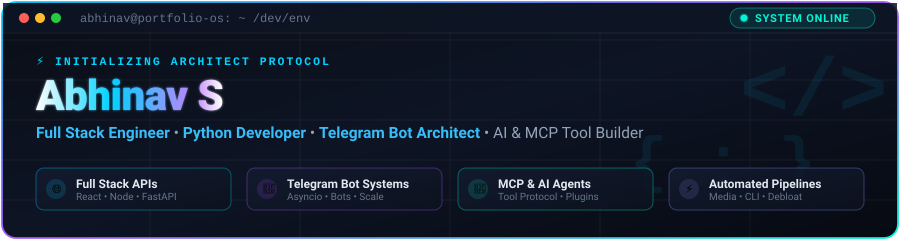
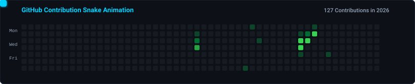

  

   

  

    

  

 

## About

I'm **Abhinav S** — I build full-stack web apps, Telegram bots, MCP tools, and automation scripts.

Most of my work involves **Python**, **TypeScript**, and **Node.js**. I like clean async code, useful CLI tools, and making things that actually work.

Currently interested in the **Model Context Protocol** ecosystem and building developer tools around it.

  

 

## Tech Stack

  
    
  
    
  

 

  

 

## Projects

| Project | What it does | Built with |
|---------|-------------|------------|
| [**vsixmcp**](https://github.com/abhinavstechdev/vsixmcp) | VS Code extension that uses MCP for contextual code assistance | TypeScript |
| [**chatgptmcpguide**](https://github.com/abhinavstechdev/chatgptmcpguide) | Guide and templates for building ChatGPT plugins and MCP servers | Python |
| [**android-adb-debloat**](https://github.com/abhinavstechdev/android-adb-debloat) | Safe Android debloating via ADB with device-specific profiles | PowerShell |
| [**autoclipper**](https://github.com/abhinavstechdev/autoclipper) | Automated video clipping and processing pipeline | Python |
| [**ForgeCodebynodejs**](https://github.com/abhinavstechdev/ForgeCodebynodejs) | Code generation and developer tooling workbench | TypeScript |
| [**product-manager**](https://github.com/abhinavstechdev/product-manager) | Product management application | TypeScript |
| [**microtool-hub**](https://github.com/abhinavstechdev/microtool-hub) | Collection of small web-based utility tools | PHP |

I also build Telegram bots (media streaming, file storage, automated moderation) using Python async frameworks like aiogram and telethon — most of those repos are private.

 

  

 

## Stats

  
  

 

  

 

  

 

  

 

## Contribution Snake

  <picture>
    <source media="(prefers-color-scheme: dark)" srcset="./assets/github-contribution-grid-snake-dark.svg">
    <source media="(prefers-color-scheme: light)" srcset="./assets/github-contribution-grid-snake.svg">
    
  </picture>

 

  

 

## Connect

  
  
  

