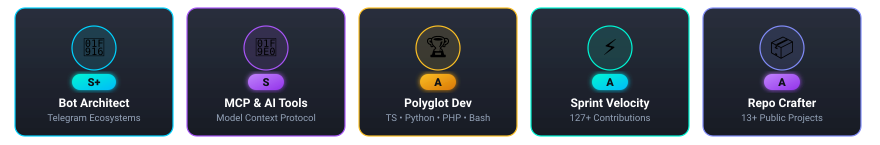

<div align="center">

  <!-- ==================== HERO ANIMATED BANNER ==================== -->
  <a href="https://github.com/abhinavstechdev">
    
  </a>

  <br/><br/>

  <!-- ==================== ROTATING TYPING ANIMATION ==================== -->
  <a href="https://github.com/abhinavstechdev">
    
  </a>

  <br/>

  <!-- Quick Status & Metric Badges -->
  <p align="center">
    
    
    
    
  </p>

  

</div>

<!-- ==================== TERMINAL INTRO / ABOUT ==================== -->

### <picture><source media="(prefers-color-scheme: dark)" srcset="https://raw.githubusercontent.com/Tarikul-Islam-Anik/Animated-Fluent-Emojis/master/Emojis/Objects/Laptop.png"></picture> Terminal Profile

```bash
abhinav@devbox:~$ curl -s https://api.abhinav.dev/identity | jq .
{
  "name": "Abhinav S",
  "handle": "abhinavstechdev",
  "role": "Full Stack Engineer & Telegram Bot Architect",
  "core_competencies": [
    "High-Concurrency Telegram Bot Ecosystems",
    "Scalable Full-Stack Web Applications & Microservices",
    "Model Context Protocol (MCP) Tooling & AI Agents",
    "Automated Media Processing & Video Pipelines",
    "Android ADB Automation & System Debloating"
  ],
  "philosophy": "Clean architecture, asynchronous velocity, and rock-solid reliability.",
  "availability": "Open for high-impact software engineering & bot architectures"
}
```

<div align="center">
  
</div>

<!-- ==================== TECH STACK & ARSENAL ==================== -->

### <picture><source media="(prefers-color-scheme: dark)" srcset="https://raw.githubusercontent.com/Tarikul-Islam-Anik/Animated-Fluent-Emojis/master/Emojis/Objects/Gear.png"></picture> Technical Arsenal &amp; Capabilities

#### ⚡ Core Programming Languages
<p align="center">
  <a href="https://skillicons.dev">
    
  </a>
</p>

#### 🌐 Frameworks &amp; Backend Runtimes
<p align="center">
  <a href="https://skillicons.dev">
    
  </a>
</p>

#### 🗄️ Databases &amp; Persistent Storage
<p align="center">
  <a href="https://skillicons.dev">
    
  </a>
</p>

#### 🛠️ DevOps, Environments &amp; Tools
<p align="center">
  <a href="https://skillicons.dev">
    
  </a>
</p>

#### 🤖 Specialized Engineering Domains
<p align="center">
  
  
  
  
  
</p>

<div align="center">
  
</div>

<!-- ==================== FEATURED PROJECTS ==================== -->

### <picture><source media="(prefers-color-scheme: dark)" srcset="https://raw.githubusercontent.com/Tarikul-Islam-Anik/Animated-Fluent-Emojis/master/Emojis/Travel%20and%20places/Rocket.png"></picture> Featured Engineering Highlights

<table width="100%">
  <tr>
    <td width="50%" valign="top">
      <h4>🧠 <a href="https://github.com/abhinavstechdev/vsixmcp">vsixmcp</a></h4>
      <p>AI-powered developer coding assistant utilizing the <b>Model Context Protocol (MCP)</b> for deep contextual codebase understanding directly inside VS Code environments.</p>
      <p>
        
        
        
      </p>
    </td>
    <td width="50%" valign="top">
      <h4>📖 <a href="https://github.com/abhinavstechdev/chatgptmcpguide">chatgptmcpguide</a></h4>
      <p>Comprehensive guide, documentation repository, templates, and validation toolchain for building ChatGPT plugins, MCP servers, and MCP Apps interactive user interfaces.</p>
      <p>
        
        
        
      </p>
    </td>
  </tr>
  <tr>
    <td width="50%" valign="top">
      <h4>📱 <a href="https://github.com/abhinavstechdev/android-adb-debloat">android-adb-debloat</a></h4>
      <p>Professional AI skill and automated suite for safe Android ADB debloating, package analysis, system optimization, and recovery with specialized Vivo and iQOO heuristics.</p>
      <p>
        
        
        
      </p>
    </td>
    <td width="50%" valign="top">
      <h4>🎬 <a href="https://github.com/abhinavstechdev/autoclipper">autoclipper</a></h4>
      <p>Automated video processing pipeline for programmatic clipping, highlight detection, and smart compression powered by Python media automation libraries.</p>
      <p>
        
        
        
      </p>
    </td>
  </tr>
  <tr>
    <td width="50%" valign="top">
      <h4>🤖 <a href="https://github.com/abhinavstechdev">Telegram Bot Ecosystem</a></h4>
      <p>Suite of high-performance Telegram bots built with asynchronous frameworks handling media streaming, link generation, giveaways, file storage, and automated moderation.</p>
      <p>
        
        
        
      </p>
    </td>
    <td width="50%" valign="top">
      <h4>🛠️ <a href="https://github.com/abhinavstechdev/ForgeCodebynodejs">ForgeCodebynodejs</a></h4>
      <p>Full-stack developer workbench and automated code generation system engineered with TypeScript and Node.js for developer velocity and rapid prototyping.</p>
      <p>
        
        
        
      </p>
    </td>
  </tr>
</table>

<div align="center">
  
</div>

<!-- ==================== GITHUB STATISTICS ==================== -->

### <picture><source media="(prefers-color-scheme: dark)" srcset="https://raw.githubusercontent.com/Tarikul-Islam-Anik/Animated-Fluent-Emojis/master/Emojis/Objects/Bar%20Chart.png"></picture> GitHub Analytics &amp; Performance

<div align="center">

  <!-- Row 1: GitHub Stats & Top Languages -->
  <table>
    <tr>
      <td align="center" valign="middle">
        <a href="https://github.com/abhinavstechdev">
          
        </a>
      </td>
      <td align="center" valign="middle">
        <a href="https://github.com/abhinavstechdev">
          
        </a>
      </td>
    </tr>
  </table>

  <!-- Row 2: Streak Statistics Card -->
  <p align="center">
    <a href="https://github.com/abhinavstechdev">
      
    </a>
  </p>

  <!-- Row 3: Contribution Velocity Graph -->
  <p align="center">
    <a href="https://github.com/abhinavstechdev">
      
    </a>
  </p>

  <!-- Row 4: Developer Trophies -->
  <p align="center">
    <a href="https://github.com/abhinavstechdev">
      
    </a>
  </p>

  

</div>

<!-- ==================== CONTRIBUTION SNAKE ANIMATION ==================== -->

### <picture><source media="(prefers-color-scheme: dark)" srcset="https://raw.githubusercontent.com/Tarikul-Islam-Anik/Animated-Fluent-Emojis/master/Emojis/Animals/Snake.png"></picture> Contribution Grid Journey

<div align="center">
  <picture>
    <source media="(prefers-color-scheme: dark)" srcset="./assets/github-contribution-grid-snake-dark.svg">
    <source media="(prefers-color-scheme: light)" srcset="./assets/github-contribution-grid-snake.svg">
    
  </picture>
  <p align="center">
    <sub>🎮 Automated continuous generation via <a href="https://github.com/Platane/snk">Platane/snk</a> and GitHub Actions</sub>
  </p>
  
</div>

<!-- ==================== SOCIAL & CONNECT SECTION ==================== -->

### <picture><source media="(prefers-color-scheme: dark)" srcset="https://raw.githubusercontent.com/Tarikul-Islam-Anik/Animated-Fluent-Emojis/master/Emojis/Hand%20gestures/Handshake.png"></picture> Let's Connect &amp; Build

<div align="center">

  <p>
    Have an interesting project, Telegram bot requirement, or open-source collaboration in mind?
    <br/>
    Let's talk and build something powerful together.
  </p>

  <p align="center">
    <a href="https://github.com/abhinavstechdev" target="_blank">
      
    </a>
    <a href="https://abhinavstechdev.github.io" target="_blank">
      
    </a>
    <a href="https://t.me/abhinavstechdev" target="_blank">
      
    </a>
    <a href="mailto:103198262+Lukerman@users.noreply.github.com" target="_blank">
      
    </a>
  </p>

  <br/>

  <p align="center">
    <sub>⚡ Designed with modern developer aesthetics, smooth SVG animations, and electric neon gradients.</sub>
    <br/>
    <sub>© 2026 Abhinav S (abhinavstechdev). All rights reserved.</sub>
  </p>

</div>
